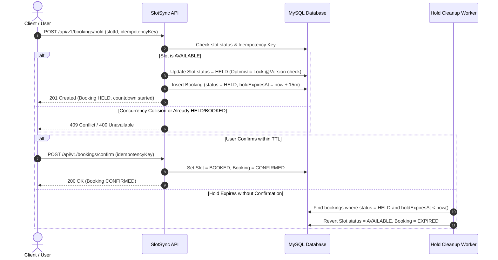
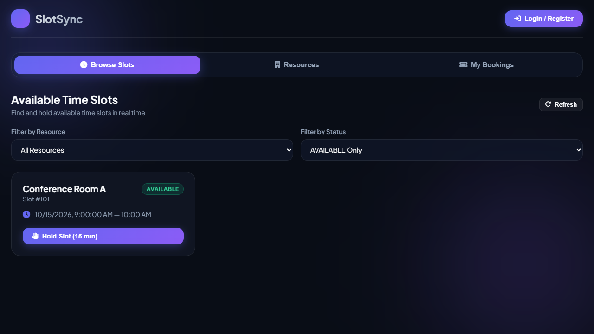
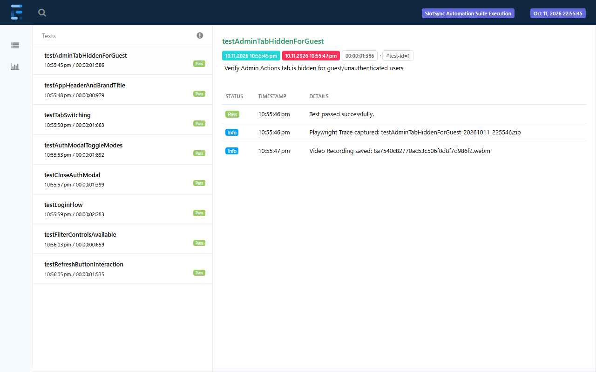

# ⚡ SlotSync — High-Concurrency Slot Reservation & Lock Engine

[](https://openjdk.org/)
[](https://spring.io/projects/spring-boot)
[](https://www.mysql.com/)
[](https://flywaydb.org/)
[](https://playwright.dev/java/)
[](http://localhost:8088/swagger-ui.html)
[](LICENSE)

> **SlotSync** is an enterprise-grade slot reservation and resource booking platform built with **Spring Boot 3** and **MySQL**. It solves real-world high-concurrency race conditions and double-booking problems using **JPA Optimistic Locking (`@Version`)**, a **Two-Phase Reservation Protocol (Hold & Confirm)**, guaranteed **API Idempotency**, background **TTL expiration schedulers**, and automated **Playwright E2E regression testing**.

---

## 📑 Table of Contents

- [Overview & Problem Statement](#-overview--problem-statement)
- [Core Architecture & Concurrency Strategy](#-core-architecture--concurrency-strategy)
  - [Two-Phase Booking Protocol](#two-phase-booking-protocol)
  - [Optimistic Locking & Race-Condition Prevention](#optimistic-locking--race-condition-prevention)
  - [Idempotent Hold Operations](#idempotent-hold-operations)
  - [Automated TTL Hold Cleanup Scheduler](#automated-ttl-hold-cleanup-scheduler)
- [Tech Stack](#-tech-stack)
- [Project Structure](#-project-structure)
- [Database Schema](#-database-schema)
- [REST API Endpoints](#-rest-api-endpoints)
- [Web UI Dashboard](#-web-ui-dashboard)
- [End-to-End Testing & Automation (Playwright + TestNG)](#-end-to-end-testing--automation-playwright--testng)
- [Getting Started](#-getting-started)
  - [Prerequisites](#prerequisites)
  - [1. Clone Repository](#1-clone-repository)
  - [2. Start Database with Docker](#2-start-database-with-docker)
  - [3. Configure Application](#3-configure-application)
  - [4. Build & Run Application](#4-build--run-application)
- [Running Automated Tests](#-running-automated-tests)
- [Configuration Reference](#-configuration-reference)
- [License](#-license)

---

## 🎯 Overview & Problem Statement

In ticketing, medical appointment booking, and conference room scheduling, high traffic spikes often cause multiple users to attempt booking the exact same time slot simultaneously:

```
User A ───► [Read: Slot is AVAILABLE] ───► [Book Slot] ───► Race Condition!
User B ───► [Read: Slot is AVAILABLE] ───► [Book Slot] ───► Double Booking!
```

**SlotSync solves this natively at scale:**
1. **Optimistic Locking (`@Version`)**: Detects concurrent collision at the database write boundary without costly table-level blocking.
2. **Two-Phase Lock (Hold -> Confirm)**: Grants users a temporary hold (e.g., 15-minute checkout window). If payment or confirmation is not received before TTL expiration, the slot is automatically released back to the general pool.
3. **Strict Idempotency**: Clients supply unique `idempotencyKey` values, protecting against accidental double submissions, network retries, and duplicate charges.

---

## 🏛 Core Architecture & Concurrency Strategy

### Two-Phase Booking Protocol



### Optimistic Locking & Race-Condition Prevention
- Every slot record contains a `version` column mapped to JPA `@Version`.
- When multiple requests attempt to acquire a hold on the same slot, the first transaction commits and increments the version counter.
- Competing concurrent transactions encounter an `OptimisticLockingFailureException` and are safely rejected, preventing double-booking without holding heavy database locks.

### Idempotent Hold Operations
- Each booking attempt requires a client-generated UUID `idempotencyKey`.
- If a client resends a request due to network timeout or duplicate clicks:
  - If the booking already exists for that user, the API immediately returns the existing booking details safely without duplicating database records.
  - If the key is reused across another user, an authorization error is raised.

### Automated TTL Hold Cleanup Scheduler
- A scheduled background worker (`HoldCleanupScheduler`) runs at regular intervals (default: every 30 seconds).
- It queries all bookings where `status = 'HELD'` and `hold_expires_at < NOW()`, atomically resetting the associated slot back to `AVAILABLE` and marking the booking as `EXPIRED`.

---

## 💻 Tech Stack

| Domain | Technology / Library | Description |
| :--- | :--- | :--- |
| **Backend Framework** | [Spring Boot 3.3.4](https://spring.io/projects/spring-boot) | Modern Java framework with Web, Data JPA, Security & Actuator |
| **Language** | [Java 17 LTS](https://openjdk.org/) | Modern language features, records, and pattern matching |
| **Database** | [MySQL 8.0](https://www.mysql.com/) | Relational database with transactional ACID guarantees |
| **Schema Migrations** | [Flyway](https://flywaydb.org/) | Version-controlled, reproducible SQL database migrations |
| **Authentication** | [Spring Security](https://spring.io/projects/spring-security) + [JJWT 0.12.6](https://github.com/jwtk/jjwt) | Stateless JWT tokens with role-based access control (`USER`, `ADMIN`) |
| **API Documentation** | [SpringDoc OpenAPI 2.6.0](https://springdoc.org/) | OpenAPI 3.0 specification & interactive Swagger UI |
| **Containerization** | [Docker](https://www.docker.com/) & [Docker Compose](https://docs.docker.com/compose/) | Isolated local database setup with health checks |
| **UI Dashboard** | Vanilla HTML5, CSS3, Modern JS (ES6+) | Glassmorphism responsive dark-mode UI with live hold countdown timers |
| **E2E Automation** | [Microsoft Playwright for Java 1.48](https://playwright.dev/java/) | Cross-browser UI testing engine |
| **Test Runner** | [TestNG 7.10](https://testng.org/) + [Surefire](https://maven.apache.org/surefire/) | Parallel test suite orchestration and execution |
| **Reporting & Tracing** | [ExtentReports 5.1.2](https://www.extentreports.com/) | Rich HTML test reporting with embedded failure screenshots and video recordings |

---

## 📂 Project Structure

```text
slot-lock-api/
├── docker-compose.yml              # Local MySQL 8 container configuration
├── pom.xml                         # Maven dependencies & build setup
├── testng.xml                      # TestNG test suite configuration
├── src/
│   ├── main/
│   │   ├── java/com/gp/slotsync/
│   │   │   ├── SlotSyncApplication.java      # Application entrypoint (@EnableScheduling)
│   │   │   ├── config/                       # OpenAPI & Swagger configurations
│   │   │   ├── controller/                   # REST controllers (Auth, Slot, Booking, Resource)
│   │   │   ├── dto/                          # Immutable Request & Response DTO records
│   │   │   ├── entity/                       # JPA entities (User, Resource, Slot, Booking)
│   │   │   ├── enums/                        # Status enums (SlotStatus, BookingStatus, Role)
│   │   │   ├── exception/                    # Global exception handlers & business errors
│   │   │   ├── repository/                   # Spring Data JPA repositories
│   │   │   ├── scheduler/                    # HoldCleanupScheduler (TTL release engine)
│   │   │   ├── security/                     # JWT filter, UserDetailsService & SecurityConfig
│   │   │   └── service/                      # Core transactional domain services
│   │   └── resources/
│   │       ├── application.yml               # Application configuration & connection strings
│   │       ├── db/migration/V1__init.sql     # Flyway database DDL schema migration
│   │       └── static/                       # Web UI Dashboard (HTML, CSS, JS)
│   └── test/
│       ├── java/com/gp/slotsync/
│       │   ├── e2e/                          # Playwright + TestNG E2E test framework
│       │   │   ├── base/                     # Playwright browser lifecycle management
│       │   │   ├── config/                   # ConfigReader for test environments
│       │   │   ├── listeners/                # ExtentReports & failure screenshot listener
│       │   │   ├── pages/                    # Page Object Model (POM) classes
│       │   │   ├── tests/                    # E2E test suites (Auth, Slots, Navigation)
│       │   │   └── utils/                    # Report manager & screenshot utilities
│       │   └── service/                      # Mockito unit tests for core services
│       └── resources/
│           └── config.properties             # Playwright test execution parameters
├── test-recordings/                          # Auto-generated browser test execution videos
└── test-reports/                             # ExtentReports HTML test reports & screenshots
```

---

## 🗄 Database Schema

The database schema is managed via Flyway (`V1__init.sql`):

```text
+-------------------+       1:N       +-------------------+
|     resources     | <-------------- |       slots       |
+-------------------+                 +-------------------+
| id (PK)           |                 | id (PK)           |
| name              |                 | resource_id (FK)  |
| type              |                 | start_time        |
| active            |                 | end_time          |
+-------------------+                 | status            |
                                      | version (@Version)|
                                      +-------------------+
                                                ^
+-------------------+                           | 1:N
|       users       |                           |
+-------------------+                 +-------------------+
| id (PK)           | <-------------- |     bookings      |
| name              |       1:N       +-------------------+
| email (UQ)        |                 | id (PK)           |
| password          |                 | user_id (FK)      |
| role (USER/ADMIN) |                 | slot_id (FK)      |
+-------------------+                 | status            |
                                      | idempotency_key   |
                                      | hold_expires_at   |
                                      | created_at        |
                                      +-------------------+
```

---

## 📡 REST API Endpoints

All endpoints are documented via Swagger UI at `http://localhost:8088/swagger-ui.html`.

### Authentication (`/api/v1/auth`)
| Method | Endpoint | Access | Description |
| :--- | :--- | :--- | :--- |
| `POST` | `/api/v1/auth/register` | Public | Register a new user (`USER` or `ADMIN`) and return JWT token |
| `POST` | `/api/v1/auth/login` | Public | Authenticate user credentials and return JWT token |

### Resource Management (`/api/v1/resources`)
| Method | Endpoint | Access | Description |
| :--- | :--- | :--- | :--- |
| `GET` | `/api/v1/resources` | Authenticated | List all resources (optional `?activeOnly=true`) |
| `GET` | `/api/v1/resources/{id}` | Authenticated | Get resource details by ID |
| `POST` | `/api/v1/resources` | Admin | Create a new bookable resource |
| `PUT` | `/api/v1/resources/{id}` | Admin | Update resource details |
| `DELETE`| `/api/v1/resources/{id}` | Admin | Soft-delete / deactivate a resource |

### Slot Operations (`/api/v1/slots`)
| Method | Endpoint | Access | Description |
| :--- | :--- | :--- | :--- |
| `GET` | `/api/v1/slots` | Authenticated | Query slots by `resourceId`, `status`, and date/time range |
| `GET` | `/api/v1/slots/{id}` | Authenticated | Get specific slot details |
| `POST` | `/api/v1/slots` | Admin | Create a slot window for a resource |

### Booking & Concurrency Engine (`/api/v1/bookings`)
| Method | Endpoint | Access | Description |
| :--- | :--- | :--- | :--- |
| `POST` | `/api/v1/bookings/hold` | Authenticated | **Phase 1**: Reserve slot with idempotency key and TTL |
| `POST` | `/api/v1/bookings/confirm` | Authenticated | **Phase 2**: Finalize held booking before TTL expiration |
| `POST` | `/api/v1/bookings/{id}/cancel` | Authenticated | Cancel booking & immediately return slot to `AVAILABLE` |
| `GET` | `/api/v1/bookings/my-bookings`| Authenticated | Retrieve all bookings made by the logged-in user |

---

## 🖥 Web UI Dashboard

SlotSync ships with an integrated responsive web application hosted on the root server:
- **Interactive Slot Browser**: View real-time status badges (`AVAILABLE`, `HELD`, `BOOKED`).
- **Live Countdown Timers**: Automatically displays remaining hold time before expiration.
- **Resource Directory**: Browse meeting rooms, doctor consultation slots, or event facilities.
- **My Bookings Panel**: Instant one-click confirmation and cancellation controls.
- **Admin Control Suite**: Real-time modal to add new resources and time slot schedules.

<p align="center">
  
</p>

Access the UI at: **`http://localhost:8088`**

---

## 🧪 End-to-End Testing & Automation (Playwright + TestNG)

The project includes an automated end-to-end regression suite using **Microsoft Playwright for Java**:

- **Page Object Model (POM)**: Modular separation of selectors and page actions (`NavigationBar`, `AuthModalPage`, `SlotsPage`).
- **Cross-Browser & Headless Control**: Supports Chromium, Chrome, Firefox, and WebKit configured via `config.properties`.
- **Automatic Failure Screenshots**: Playwright captures Base64 and PNG screenshots on test failure.
- **Full Video & Trace Recording**: All test execution video sessions are saved under `test-recordings/`.
- **Interactive HTML Reports**: TestNG listener automatically outputs detailed execution reports to `test-reports/ExtentReport.html`.

<p align="center">
  
</p>

---

## 🚀 Getting Started

### Prerequisites
- **Java 17 JDK** or higher installed
- **Apache Maven 3.8+**
- **Docker & Docker Compose** (for running MySQL)

### 1. Clone Repository
```bash
git clone https://github.com/ganeshpatil2906/slot-lock-api.git
cd slot-lock-api
```

### 2. Start Database with Docker
Launch the pre-configured MySQL 8.0 container:
```bash
docker compose up -d
```
*Healthcheck verifies when the MySQL database is ready to accept connections on port `3306`.*

### 3. Configure Application
By default, `src/main/resources/application.yml` connects to `localhost:3306` using user `root` and password `root`. You can override any configuration using environment variables:

| Variable | Default Value | Description |
| :--- | :--- | :--- |
| `SPRING_DATASOURCE_URL` | `jdbc:mysql://localhost:3306/slotsync` | Database connection URL |
| `SPRING_DATASOURCE_USERNAME` | `root` | Database username |
| `SPRING_DATASOURCE_PASSWORD` | `root` | Database password |
| `JWT_SECRET` | *(Generated 256-bit key)* | HMAC-SHA secret for token signing |
| `JWT_EXPIRATION_MS` | `86400000` (24 hours) | JWT token lifespan |
| `HOLD_DEFAULT_MINUTES` | `15` | Default duration for temporary slot holds |
| `SERVER_PORT` | `8088` | HTTP server port |

### 4. Build & Run Application
```bash
mvn clean spring-boot:run
```
Upon startup:
- Flyway automatically creates the database tables.
- Web UI is live at: `http://localhost:8088`
- Swagger OpenAPI documentation is live at: `http://localhost:8088/swagger-ui.html`

---

## 🧪 Running Automated Tests

### Run Unit Tests
Execute Mockito service unit tests:
```bash
mvn test -Dtest=*ServiceTest
```

### Run Playwright E2E Suite via TestNG
Execute end-to-end browser tests:
```bash
mvn test -DsuiteXmlFile=testng.xml
```

To run Playwright tests in headed mode with visual browser window:
```bash
mvn test -DsuiteXmlFile=testng.xml -Dheadless=false
```

### View Test Reports & Recordings
After running tests:
- Open `test-reports/ExtentReport.html` in any browser to review the visual test execution log.
- Check `test-recordings/` for `.webm` video recordings of the test execution sessions.

---

## ⚙ Configuration Reference

### Application Settings (`application.yml`)
```yaml
spring:
  datasource:
    url: jdbc:mysql://localhost:3306/slotsync?createDatabaseIfNotExist=true&useSSL=false&allowPublicKeyRetrieval=true&serverTimezone=UTC
    username: root
    password: root
  flyway:
    enabled: true

jwt:
  secret: ${JWT_SECRET:404E635266556A586E3272357538782F413F4428472B4B6250645367566B5970}
  expiration-ms: 86400000
  hold-default-minutes: 15

server:
  port: 8088
```

### Playwright E2E Settings (`src/test/resources/config.properties`)
```properties
baseUrl=http://localhost:8088
browser=chromium
channel=chrome
headless=true
timeout=10000
recordVideo=true
videoDir=test-recordings
recordTrace=true
traceDir=test-recordings/traces
reportDir=test-reports
screenshotDir=test-reports/screenshots
```

---

## 📄 License

This project is open-sourced under the [MIT License](LICENSE).
